# NutriVision AI — RAG Architecture & Vector Intelligence Guide
# নিউট্রিভিশন এআই — আরএজি (RAG) আর্কিটেকচার ও ভেক্টর ইন্টেলিজেন্স গাইড

---

## Part 1: English Reference

### 1. Current State: Is RAG Implemented in the Repository?

**Direct Answer**:
A **foundational vector database infrastructure (ChromaDB)** is implemented in the codebase, but it currently operates as an **exact-hash semantic cache scaffold** rather than a full semantic embedding Retrieval-Augmented Generation (RAG) pipeline.

#### Location & Directory
- **Cache Module**: [`app/cache/vector_cache.py`](file:///Users/bikashtalukder/cloud-camp-hackathon/app/cache/vector_cache.py)
- **Vector Storage Directory**: `app/cache/chroma/` (persistent local ChromaDB client)
- **Settings Configuration**: `CHROMA_CACHE_PATH` in [`app/config/settings.py`](file:///Users/bikashtalukder/cloud-camp-hackathon/app/config/settings.py) and `app/.env.example`
- **Integration Seam**: [`app/api/vision.py`](file:///Users/bikashtalukder/cloud-camp-hackathon/app/api/vision.py) (Step 1 of the vision analysis pipeline)

#### What It Currently Does
1. **Initializes ChromaDB**: Uses `chromadb.PersistentClient(path="app/cache/chroma")` and gets or creates a collection named `vision_detections` with cosine distance space (`{"hnsw:space": "cosine"}`).
2. **Exact-Match Storage**: It hashes the incoming image data URI using SHA-256 (`hashlib.sha256(f"live-vision-v1:{image_ref}".encode("utf-8")).hexdigest()`).
3. **Lookup & Cache**:
   - `has(image_ref)`: Checks if the hash ID exists in the ChromaDB collection.
   - `get(image_ref)`: Retrieves the cached JSON-encoded `list[DetectedItem]`.
   - `put(image_ref, detected)`: Upserts the detected items JSON into the ChromaDB collection.
4. **Graceful Degradation**: If ChromaDB is not installed or the directory is unwritable, the cache gracefully turns into a no-op, falling back to SQLite TTL cache and live AI calls without crashing.

#### Why It Is Not Yet a Full RAG System
- **No Vector Embeddings Generated**: Images are not passed through an image encoder (like CLIP or SigLIP) to generate vector embeddings. The ChromaDB documents are indexed strictly by SHA-256 ID strings.
- **No Nearest-Neighbor Vector Retrieval**: A photo taken from a slightly different angle, with different lighting, or with a 1-pixel difference produces a different SHA-256 hash, causing a cache miss.
- **No Retrieval-Augmented LLM Prompting**: It returns cached detections directly; it does not retrieve external culinary knowledge or clinical medical guidelines to augment the generation prompt sent to Gemini or Groq.

---

### 2. What Can We Do With Full RAG in NutriVision AI?

Upgrading the existing ChromaDB foundation into a complete RAG system unlocks four high-impact architectural capabilities:

```mermaid
flowchart TD
    subgraph Input ["1. User Inputs"]
        IMG["Meal Photo (Image)"]
        USR["User Profile (e.g., Diabetic, Hypertensive)"]
    end

    subgraph RAG_Engines ["2. ChromaDB RAG Engine"]
        direction TB
        V_RAG["Pillar 1: Multimodal Image RAG (SigLIP / CLIP)<br/>Vector search for visually similar dishes (cosine > 0.92)"]
        K_RAG["Pillar 2: Culinary Recipe Knowledge RAG<br/>Bangladeshi/Indian recipes, hidden oils, ghee & spices"]
        C_RAG["Pillar 3: Clinical Nutrition & Medical RAG<br/>ADA, WHO, KDIGO diabetes & hypertension guidelines"]
        G_RAG["Pillar 4: Hyper-Local Grocery Alternative RAG<br/>Local healthy ingredient swaps (e.g. brown rice, millets)"]
    end

    subgraph Augmentation ["3. Augmented Context Generation"]
        CTX["Context: Authentic cooking methods + Clinical limits + Swaps"]
        LLM["Generative LLM (Gemini 2.0 / Groq Qwen)"]
    end

    subgraph Output ["4. Output"]
        RES["Precise Macros, Clinical Warnings & Actionable Health Advice"]
    end

    IMG --> V_RAG
    V_RAG -- "Near-match hit" --> RES
    V_RAG -- "Miss: New Image" --> LLM
    IMG --> K_RAG
    USR --> C_RAG
    K_RAG --> CTX
    C_RAG --> CTX
    CTX --> LLM
    LLM --> G_RAG
    G_RAG --> RES
```



#### Pillar 1: Multimodal Visual Semantic RAG (CLIP / SigLIP)
- **The Problem**: Right now, if a user snaps a photo of white rice and chicken curry today, and snaps another photo of the same meal tomorrow under different lighting, the system calls Gemini or Groq again.
- **The RAG Solution**:
  1. Use a lightweight embedding model (e.g., `google/siglip-base-patch16-224` or `sentence-transformers/clip-ViT-B-32`).
  2. Embed incoming food images into a 512-dimensional vector space.
  3. Query ChromaDB with cosine similarity:
     `collection.query(query_embeddings=[image_vec], n_results=1)`
  4. If cosine similarity > 0.92, retrieve the detection and portion template immediately.
- **Impact**: Zero external API cost, < 20ms response time, completely resilient to external API outages.

#### Pillar 2: South Asian Recipe & Culinary Knowledge RAG
- **The Problem**: Off-the-shelf LLMs have Western biases and often fail to estimate hidden ingredients in South Asian home-cooking (e.g., 2 tablespoons of mustard oil in *Shorshe Ilish*, sugar in *Cholar Dal*, or ghee in *Biryani*).
- **The RAG Solution**:
  1. Index curated regional culinary datasets (e.g., Bangladesh National Food Composition Tables, Indian Food Composition Tables, traditional recipe corpora) into ChromaDB.
  2. When vision detects `["Rice", "Ilish Fish", "Mustard Gravy"]`, the system queries ChromaDB for the standard recipe formulation.
  3. Augmented Prompt:
     ```
     Context from Culinary Knowledge Base:
     - Traditional Shorshe Ilish (1 serving): 150g Hilsa, 20g Mustard seed paste, 15ml Mustard oil, 2 green chillies.
     - Added sodium: ~450mg. Cooking fat: Monounsaturated + saturated fats totaling ~18g.
     Use this exact formulation to determine macros instead of generic fish curry assumptions.
     ```
- **Impact**: Eliminates generic estimation errors; provides authentic macro/micro breakdowns for local diets.

#### Pillar 3: Clinical Guidelines & Medical Explainability RAG
- **The Problem**: Providing medical and dietary advice (e.g. for diabetes or kidney disease) with raw LLM outputs risks hallucinations or generic non-actionable advice.
- **The RAG Solution**:
  1. Ingest peer-reviewed clinical guidelines into ChromaDB:
     - American Diabetes Association (ADA) Standards of Care (Glycemic targets, carbohydrate thresholds per meal).
     - Kidney Disease: Improving Global Outcomes (KDIGO) (Potassium, phosphorus, and protein limits).
     - World Health Organization / American Heart Association (Sodium caps: < 2,000mg/day).
  2. When generating the personalized *"Why these flags?"* explainability strip:
     - Retrieve relevant medical rule chunks matching the user's profile conditions and the detected meal nutrients.
     - Formulate grounded explanations with clinical backing:
       *"The detected 75g of white rice carries a high glycemic load (GL > 20). According to ADA clinical standards, meals exceeding 45g available carbs trigger rapid postprandial glucose spikes for Type 2 diabetes."*
- **Impact**: Trustworthy, clinically validated health explainability that doctors and dietitians can rely on.

#### Pillar 4: Hyper-Local Grocery & Ingredient Swap RAG
- **The Problem**: Telling a user *"Stop eating rice"* is unhelpful if they do not know affordable, culturally acceptable alternatives.
- **The RAG Solution**:
  1. Index local market grocery items with prices, nutritional density, and glycemic indexes into ChromaDB.
  2. When a meal has high-GI rice, ChromaDB retrieves:
     - *Brown Basmati Rice* (Medium GI, 2.5x fiber)
     - *Foxtail Millet / কাওনের চাল* (Low GI, high protein, affordable)
     - *Cauliflower Rice* (Ultra-low carb)
  3. Seamlessly adds the suggested swap into the user's `GroceryScreen` with localized pricing.

---

### 3. Concrete Implementation Plan (How to Activate Full RAG)

To turn the current `app/cache/vector_cache.py` into a production RAG system:

1. **Step 1: Add Image Embedding Model**:
   - Integrate `sentence-transformers` with `clip-ViT-B-32` in `app/services/image_embedder.py`.
2. **Step 2: Upgrade VectorCache**:
   - Change `VectorCache.put()` to store `embeddings=[embed_image(image_bytes)]`.
   - Change `VectorCache.get()` to execute `collection.query(query_embeddings=[query_vec], n_results=1)` with distance threshold checking.
3. **Step 3: Ingest Regional Recipes & Clinical Guidelines**:
   - Create `app/data/recipes.json` and `app/data/clinical_guidelines.json`.
   - Populate ChromaDB collections: `culinary_knowledge` and `clinical_guidelines`.
4. **Step 4: Connect Retrieval to Personalization Route**:
   - In `app/api/nutrition.py`, query `clinical_guidelines` during flag generation to inject verified medical context into the response.

---
---

## Part 2: বাংলা রেফারেন্স (Bengali Documentation)

### ১. বর্তমান অবস্থা: এই প্রজেক্টে কি RAG (Retrieval-Augmented Generation) যুক্ত আছে?

**সরাসরি উত্তর**:
প্রজেক্টটিতে একটি **ভেক্টর ডাটাবেস পরিকাঠামো (ChromaDB)** যুক্ত আছে, তবে এটি বর্তমানে একটি **এক্স্যাক্ট-হ্যাশ ক্যাশ (Exact-Hash Semantic Cache Scaffold)** হিসেবে কাজ করছে; এটি এখনও পূর্ণাঙ্গ ভেক্টর এমবেডিং ও আরএজি (RAG) পাইপলাইন হিসেবে সক্রিয় নয়।

#### ফাইলের অবস্থান ও ডিরেক্টরি
- **ক্যাশ কোড ফাইল**: [`app/cache/vector_cache.py`](file:///Users/bikashtalukder/cloud-camp-hackathon/app/cache/vector_cache.py)
- **ভেক্টর ডাটা স্টোরেজ ডিরেক্টরি**: `app/cache/chroma/` (স্থানীয় পারসিসটেন্ট ক্রোমাডিবি ফাইল)
- **কনফিগারেশন সেটিংস**: `CHROMA_CACHE_PATH` ([`app/config/settings.py`](file:///Users/bikashtalukder/cloud-camp-hackathon/app/config/settings.py) এবং `app/.env.example`)
- **ব্যবহারের স্থান**: [`app/api/vision.py`](file:///Users/bikashtalukder/cloud-camp-hackathon/app/api/vision.py) (ভিশন অ্যানালাইসিস পাইপলাইনের ধাপ ১)

#### এটি বর্তমানে কী কাজ করে?
১. **ক্রোমাডিবি ইনিশিয়ালাইজেশন**: `chromadb.PersistentClient` ব্যবহার করে `vision_detections` নামে একটি কালেকশন তৈরি করে যার ডিসট্যান্স স্পেস হলো কোসাইন (`{"hnsw:space": "cosine"}`)।
২. **ছবি হ্যাশিং**: আপলোড করা ছবির ডেটা স্ট্রিংটিকে SHA-256 দিয়ে হ্যাশ করে (`live-vision-v1:{image_ref}`) একটি অনন্য আইডি তৈরি করে।
৩. **ক্যাশ চেক ও রেজাল্ট সেভ**:
   - যদি হুবহু একই ছবি পূর্বে আপলোড হয়ে থাকে, তবে কোনো এআই কল না করেই ChromaDB থেকে সরাসরি পূর্বে শনাক্তকৃত খাবারের তথ্য (`DetectedItem[]`) ফেরত পাঠায়।
   - নতুন ছবির ক্ষেত্রে ফলাফলটি ChromaDB-তে সংরক্ষণ করে রাখে।
৪. **ব্যর্থতা প্রতিরোধ (Fallback)**: ক্রোমাডিবি ইনস্টল না থাকলে বা পাথ কাজ না করলে অ্যাপ ক্র্যাশ না করে স্বয়ংক্রিয়ভাবে SQLite ক্যাশ এবং লাইভ জেমিনি/গ্রক মডেলে চলে যায়।

#### কেন এটিকে এখনও পূর্ণাঙ্গ RAG বলা যাবে না?
- **ভেক্টর এমবেডিং তৈরি হয় না**: ছবিটিকে কোনো ভিশন এনকোডার (যেমন CLIP বা SigLIP) দিয়ে ভেক্টরে রূপান্তর করা হয় না; বরং সাধারণ SHA-256 টেক্সট হ্যাশ দিয়ে সেভ করা হয়। ফলে ছবির কোণ বা আলো একটু পরিবর্তন হলেই ক্যাশ মিস হয়।
- **তথ্য রিট্রিভ করে এলএলএম প্রম্পটে পাঠানো হয় না**: RAG-এর মূল বৈশিষ্ট্য হলো বাহ্যিক ডাটাবেস (রেসিপি, পুষ্টি গাইডলাইন) থেকে তথ্য খুঁজে এনে এলএলএম প্রম্পটের সাথে যুক্ত করা। বর্তমান কোডে শুধু পূর্বের ফলাফল ক্যাশ থেকে রিড করা হয়, কোনো প্রম্পট অগমেন্টেশন ঘটে না।

---

### ২. নিউট্রিভিশন এআই-তে RAG যুক্ত করলে কী কী অসাধারণ সুবিধা পাওয়া যাবে?

ChromaDB পরিকাঠামোকে পূর্ণাঙ্গ RAG সিস্টেমে রূপান্তর করলে অ্যাপটিতে চারটি যুগান্তকারী ফিচার যুক্ত করা সম্ভব:

```mermaid
flowchart TD
    subgraph ইনপুট ["১. ব্যবহারকারীর ইনপুট"]
        IMG["খাবারের ছবি (Image)"]
        USR["স্বাস্থ্য প্রোফাইল (ডায়াবেটিস, রক্তচাপ)"]
    end

    subgraph আরএজি_ইঞ্জিন ["২. ChromaDB ভেক্টর আরএজি (RAG) ইঞ্জিন"]
        direction TB
        V_RAG["স্তম্ভ ১: মাল্টিমোডাল ভিশন আরএজি (CLIP/SigLIP)<br/>একই ধরনের খাবারের ভেক্টর মিল খোঁজা (Cosine > 0.92)"]
        K_RAG["স্তম্ভ ২: দেশীয় রেসিপি নলেজ আরএজি<br/>বাঙালি রান্নার তেল, মশলা ও লুকানো ক্যালরি রিট্রিভাল"]
        C_RAG["স্তম্ভ ৩: ক্লিনিকাল নিউট্রিশন ও মেডিকেল আরএজি<br/>ডায়াবেটিস ও প্রেশারের আন্তর্জাতিক চিকিৎসা গাইডলাইন"]
        G_RAG["স্তম্ভ ৪: লোকাল গ্রোসারি স্বাস্থ্যকর বিকল্প আরএজি<br/>ভাতের বদলে কাওনের চাল বা ব্রাউন রাইস সাজেশন"]
    end

    subgraph অগমেন্টেশন ["৩. এআই প্রম্পট অগমেন্টেশন"]
        CTX["সঠিক রেসিপি + মেডিকেল নিয়ম + বিকল্প খাবার"]
        LLM["জেনারেটিভ এআই (Gemini 2.0 / Groq Qwen)"]
    end

    subgraph আউটপুট ["৪. চূড়ান্ত ফলাফল"]
        RES["নির্ভুল ক্যালরি, স্বাস্থ্য সতর্কতা ও বাস্তবসম্মত পরামর্শ"]
    end

    IMG --> V_RAG
    V_RAG -- "সরাসরি মিল পেলে" --> RES
    V_RAG -- "নতুন খাবার হলে" --> LLM
    IMG --> K_RAG
    USR --> C_RAG
    K_RAG --> CTX
    C_RAG --> CTX
    CTX --> LLM
    LLM --> G_RAG
    G_RAG --> RES
```

#### স্তম্ভ ১: মাল্টিমোডাল ভিশন আরএজি (CLIP / SigLIP Image RAG)
- **সমস্যা**: ব্যবহারকারী যদি প্রতিদিনের সাধারণ ভাত ও ডালের ছবি সামান্য ভিন্ন আলোতে তোলেন, সিস্টেমটি প্রতিবার ক্লাউড জেমিনি বা গ্রক এপিআই কল করে, যা সময় এবং এপিআই খরচ বাড়ায়।
- **RAG সমাধান**:
  - একটি হালকা ভিশন এনকোডার (যেমন `SigLIP` বা `CLIP`) দিয়ে প্রতিটি ছবির ৫১২-মাত্রিক ভেক্টর এমবেডিং ChromaDB-তে সংরক্ষণ করা।
  - নতুন ছবি এলে ChromaDB-তে কোসাইন সাদৃশ্য (`Cosine Similarity > 0.92`) চেক করা।
  - মিল পেলে কোনো এআই কল ছাড়াই ২০ মিলি-সেকেন্ডে নিখুঁত রেজাল্ট প্রদান করা।
- **উপকারিতা**: শূন্য এপিআই খরচ, সুপারফাস্ট গতি এবং অফলাইনেও কাজ করার ক্ষমতা।

#### স্তম্ভ ২: দেশি রান্নার রেসিপি ও লুকানো উপাদানের নলেজ RAG
- **সমস্যা**: গ্লোবাল এআই মডেলগুলো বোঝে না যে ইলিশ মাছের ঝোলে ২ চামচ খাঁটি সরিষার তেল থাকে, ছোলার ডালে চিনি দেওয়া হয়, কিংবা পোলাওয়ে ঘি থাকে। ফলে খাবারের পুষ্টি গণনায় বড় ধরনের ভুল হয়।
- **RAG সমাধান**:
  - বাংলাদেশ পুষ্টি ইনস্টিটিউট (INFS) এবং আইসিএমআর (ICMR)-এর দেশি খাবারের রেসিপি ডাটাবেস ChromaDB-তে ভেক্টর হিসেবে রাখা।
  - যখনই এআই "ইলিশ মাছের ঝোল" দেখবে, সাথে সাথে ক্রোমাডিবি থেকে খাঁটি দেশি রেসিপিটি তুলে এনে এআই প্রম্পটে যুক্ত করে দেওয়া হবে:
    *"রেফারেন্স তথ্য: ঐতিহ্যবাহী ইলিশ মাছে ১৫ মিলি সরিষার তেল, ১০ গ্রাম সরিষা বাটা ও কাঁচা মরিচ থাকে। এই অনুপাত অনুযায়ী সঠিক ফ্যাট ও সোডিয়াম গণনা করো।"*
- **উপকারিতা**: যেকোনো আন্তর্জাতিক অ্যাপের চেয়ে দেশি খাবারের পুষ্টি গণনায় ১০০% নির্ভুলতা।

#### স্তম্ভ ৩: ডায়াবেটিস ও মেডিকেল গাইডলাইন RAG (Clinical Nutrition)
- **সমস্যা**: এআই অনেক সময় সাধারণ পরামর্শ দেয় যা ডায়াবেটিস বা কিডনি রোগীর জন্য বিপজ্জনক হতে পারে (Halucination ঝুঁকি)।
- **RAG সমাধান**:
  - আন্তর্জাতিক স্বাস্থ্য নির্দেশিকা (ADA ডায়াবেটিস গাইডলাইন, WHO সোডিয়াম লিমিট, KDIGO কিডনি ডায়েট) ChromaDB-তে ইনডেক্স করা।
  - ব্যবহারকারী ডায়াবেটিক হলে এবং খাবারে অতিরিক্ত সাদা ভাত শনাক্ত হলে, RAG সিস্টেম সরাসরি এডিএ গাইডলাইনের নিয়ম তুলে ধরবে:
    *"সতর্কতা: প্রতি বেলায় ৪৫ গ্রামের বেশি কার্বোহাইড্রেট রক্তে সুগারের মাত্রা দ্রুত বৃদ্ধি করে (ADA ২০২৪ গাইডলাইন)। শনাক্তকৃত ১৫০ গ্রাম সাদা ভাতে ৫৪ গ্রাম সহজে শোষণযোগ্য কার্ব রয়েছে।"*
- **উপকারিতা**: কোনো ভুল বা ভিত্তিহীন তথ্য থাকবে না; চিকিৎসকের মতো যুক্তিযুক্ত স্বাস্থ্য পরামর্শ।

#### স্তম্ভ ৪: লোকাল বাজার ও স্বাস্থ্যকর বিকল্প খাদ্য RAG
- **সমস্যা**: শুধুমাত্র "ভাত খাওয়া কমান" বললে সমাধান হয় না, কী খাওয়া উচিত এবং তার দাম কত তা জানানো জরুরি।
- **RAG সমাধান**:
  - দেশি বাজারের সহজলভ্য স্বাস্থ্যকর উপাদানের তালিকা ChromaDB-তে রাখা।
  - ভাতের বিকল্প হিসেবে কাওনের চাল (Foxtail Millet), লাল চাল, ওটস বা ফুলকপির ভাতের তথ্য রিট্রিভ করে ব্যবহারকারীর গ্রোসারি তালিকায় যুক্ত করার পরামর্শ দেওয়া।
- **উপকারিতা**: সাধারণ মানুষের বাজেটের মধ্যে কার্যকর খাদ্যাভ্যাস পরিবর্তন।

---

### ৩. RAG বাস্তবায়নের সহজ ধাপসমূহ

১. **ধাপ ১: ইমেজ এমবেডার যুক্ত করা**: `sentence-transformers` বা `clip` লাইব্রেরি ব্যবহার করে `app/services/image_embedder.py` মডিউল তৈরি করা।
২. **ধাপ ২: VectorCache আপডেট**: ছবির SHA-256 স্ট্রিংয়ের পরিবর্তে বাস্তব ভেক্টর এমবেডিং দিয়ে ChromaDB-তে সংরক্ষণ এবং কোসাইন কোয়েরি সক্রিয় করা।
৩. **ধাপ ৩: দেশি রেসিপি ও মেডিকেল ডাটাবেস লোড**: `app/data/recipes.json` এবং `app/data/guidelines.json` তৈরি করে ChromaDB কালেকশনে আপলোড করা।
৪. **ধাপ ৪: প্রম্পট অগমেন্টেশন**: `app/api/nutrition.py`-তে ক্যালরি ও ওয়ার্নিং তৈরির সময় RAG থেকে প্রাপ্ত রেফারেন্স যুক্ত করে দেওয়া।
