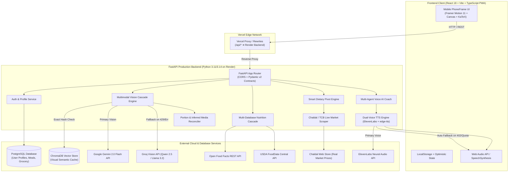
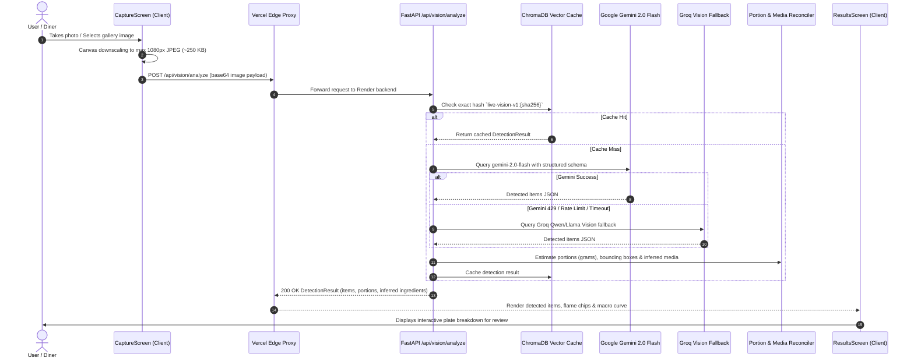
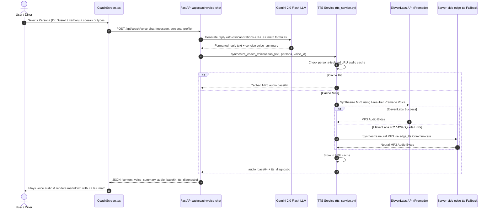
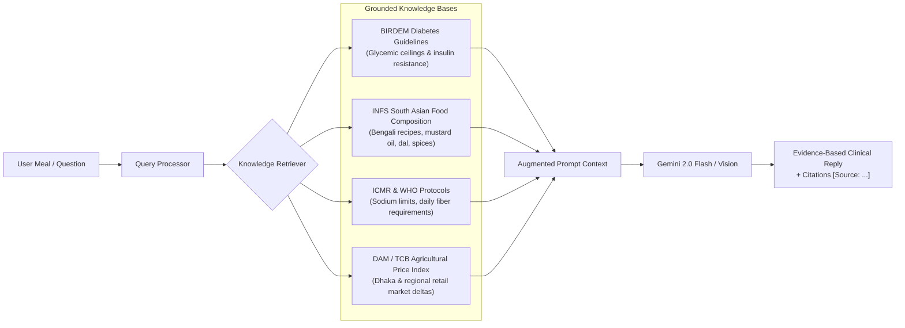
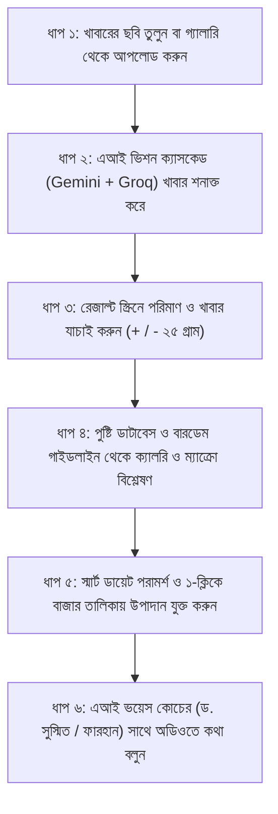

# NutriVision AI — Master End-to-End Workflow & Architecture Specification
# নিউট্রিভিশন এআই — সম্পূর্ণ এন্ড-টু-এন্ড ওয়ার্কফ্লো, সিস্টেম আর্কিটেকচার ও ব্যবহার নির্দেশিকা

> **Version:** 2.4.0 (Production Release)  
> **Platform Status:** Live on Vercel (`cloud-camp-hackathon.vercel.app`) & Render FastAPI Backend  
> **Database:** PostgreSQL (Cloud Persistence) + ChromaDB (Semantic Vector Cache)  
> **AI Vision Pipeline:** Dual Multimodal Cascade (Google Gemini 2.0 Flash + Groq Vision)  
> **Voice AI Coach:** Dual-Persona Multi-Agent TTS (ElevenLabs Premade + Server-Side `edge-tts` Fallback)  
> **Language Support:** 100% Pure Bidirectional English & বাংলা (Zero Language Mixing)  

---

## Table of Contents / সূচিপত্র
1. [Executive Summary & Core Value Proposition](#1-executive-summary--core-value-proposition)
2. [End-to-End System Architecture](#2-end-to-end-system-architecture)
   - [High-Level Architecture Diagram](#high-level-architecture-diagram)
   - [Photo-to-Nutrition Ingestion Pipeline](#photo-to-nutrition-ingestion-pipeline)
   - [Multi-Agent Voice AI Coach Pipeline](#multi-agent-voice-ai-coach-pipeline)
   - [Smart Dietary Pivot & Live Market Price Scraper](#smart-dietary-pivot--live-market-price-scraper)
   - [PostgreSQL Profile & Meal Persistence](#postgresql-profile--meal-persistence)
3. [Deep-Dive Screen Workflows](#3-deep-dive-screen-workflows)
   - [Screen 1: Capture & Image Optimization (`CaptureScreen`)](#screen-1-capture--image-optimization-capturescreen)
   - [Screen 2: Dual-Model Multimodal Vision Detection](#screen-2-dual-model-multimodal-vision-detection)
   - [Screen 3: Results, Portion Tuning & Diet Conflict Checks (`ResultsScreen`)](#screen-3-results-portion-tuning--diet-conflict-checks-resultsscreen)
   - [Screen 4: Clinical Nutrition, SHAP Explainability & Dietary Pivots (`NutrientsScreen`)](#screen-4-clinical-nutrition-shap-explainability--dietary-pivots-nutrientsscreen)
   - [Screen 5: Smart Grocery Planning & Live Market Intelligence (`GroceryScreen`)](#screen-5-smart-grocery-planning--live-market-intelligence-groceryscreen)
   - [Screen 6: Multi-Agent Voice AI Coach with KaTeX Math (`CoachScreen`)](#screen-6-multi-agent-voice-ai-coach-with-katex-math-coachscreen)
   - [Screen 7: User Profile, BMR/TDEE & Medical Goals (`ProfileScreen`)](#screen-7-user-profile-bmrtdee--medical-goals-profilescreen)
4. [RAG (Retrieval-Augmented Generation) & Knowledge Base](#4-rag-retrieval-augmented-generation--knowledge-base)
5. [Pure Bidirectional Internationalization (i18n)](#5-pure-bidirectional-internationalization-i18n)
6. [API Specification & Data Contracts](#6-api-specification--data-contracts)
7. [বাংলা সংস্করণ: সম্পূর্ণ ব্যবহার নির্দেশিকা ও সিস্টেম কার্যপ্রণালী](#7-বাংলা-সংস্করণ-সম্পূর্ণ-ব্যবহার-নির্দেশিকা-ও-সিস্টেম-কার্যপ্রণালী)

---

## 1. Executive Summary & Core Value Proposition

NutriVision AI is an intelligent clinical nutrition and automated dietary tracking progressive web app tailored specifically for South Asian, Bengali, and global cuisines.

### The 4 Fundamental Problems We Solve:
1. **Friction of Manual Logging**: 70%+ of health app users abandon tracking within 7 days due to manually searching, weighing, and typing ingredients. NutriVision logs a complete plate in under 2 seconds from a single photo.
2. **South Asian Culinary Neglect**: Western platforms (MyFitnessPal, Cronometer, Lifesum) fail at regional dishes (*Khichuri, Ilish Bhapa, Roti-Dal, Shorshe Ilish, Begun Bhorta*), forcing inaccurate western substitutions. NutriVision detects regional plates, hidden cooking media (Mustard Oil, Soybean Oil, Ghee), and accurate spices natively.
3. **High Genetic Metabolic Vulnerability**: South Asians carry an elevated genetic predisposition to Type 2 diabetes and hypertension. Rather than simple calorie-counting, NutriVision provides **Glycemic Load (GL) assessment**, **diabetic safety alerts**, and **diet conflict mitigation** grounded in official BIRDEM, ICMR, and WHO protocols.
4. **Fragility of Cloud AI APIs**: Real-world vision APIs frequently experience HTTP 429 rate limits, cloud IP blocks, or outages. NutriVision utilizes an automatic **Fail-Safe Multimodal Cascade** (Gemini 2.0 Flash $\to$ Groq Qwen/Llama) and a **Dual-Layer Voice TTS Cascade** (ElevenLabs Premade $\to$ Microsoft Neural `edge-tts`), guaranteeing continuous uptime.

---

## 2. End-to-End System Architecture

### High-Level Architecture Diagram



---

### Photo-to-Nutrition Ingestion Pipeline



---

### Multi-Agent Voice AI Coach Pipeline



---

## 3. Deep-Dive Screen Workflows

### Screen 1: Capture & Image Optimization (`CaptureScreen`)

- **Hardware Camera Access**: Direct mobile and desktop camera feed integration using HTML5 `navigator.mediaDevices.getUserMedia`.
- **Client-Side Image Optimization**: Large photos from mobile sensors (10–25 MB) are automatically compressed and scaled client-side to a max dimension of 1080px JPEG at 82% quality (~250 KB payload). This guarantees:
  - Sub-second upload times over cellular 4G/3G connections.
  - Zero payload truncation under cloud reverse proxy limits (Vercel 4.5MB limit, Render request limits).
- **Today's Intake Trajectory Curve**: Embedded `RevenueCurveChart` displays logged calorie progress against the user's daily budget without leaving the capture view.
- **Quick Actions Toolbar**: 1-tap navigation to "Log Meal" (opens shutter), "Recent Meals" (smooth scrolls to visual food diary), and "Grocery" (opens weekly shopping list).

---

### Screen 2: Dual-Model Multimodal Vision Detection

The backend vision engine ([`app/services/vision_service.py`](file:///Users/bikashtalukder/cloud-camp-hackathon/app/services/vision_service.py)) executes a resilient multimodal cascade:
1. **Semantic Vector Cache Check**:
   - Computes SHA-256 fingerprint of the image bytes.
   - Probes ChromaDB collection `live-vision-v1`. If a matching image was processed previously, returns cached food items with zero API cost and < 50ms latency.
2. **Primary Vision: Google Gemini 2.0 Flash**:
   - Calls `gemini-2.0-flash-exp` with temperature 0.2 and structured JSON schema enforcement.
   - Instructs the vision model to detect all visible dishes, side ingredients, cooking oils, and spices.
3. **Fail-Safe Fallback: Groq Vision**:
   - If Gemini returns HTTP 429 (quota exhausted), 503, or invalid JSON, the service immediately invokes Groq Vision (`qwen/qwen3.8-27b` or `llama-3.2-11b-vision-preview`).
   - Ensures user experience never breaks during peak dining hours.
4. **Portion & Inferred Media Reconciler ([`portion.py`](file:///Users/bikashtalukder/cloud-camp-hackathon/app/services/portion.py))**:
   - Estimates gram weights based on relative dish proportions.
   - Infers hidden culinary ingredients (e.g. Olive Oil, Mustard Oil, Ghee, Salt, Black Pepper, Garlic) to ensure cooking fats are never overlooked in macro counts.

---

### Screen 3: Results, Portion Tuning & Diet Conflict Checks (`ResultsScreen`)

- **3-Step Guided Step Indicator**:
  - `Step 1: Review (পর্যালোচনা)`: Inspect detected items, visual confidence tags, and kcal flame chips.
  - `Step 2: Adjust (সমন্বয়)`: Modify portion sizes using increment/decrement buttons (`+`/`-` 25g) or long-press slider (5g–800g), rename items, or add custom pantry items via modal.
  - `Step 3: Confirm (নিশ্চিতকরণ)`: Final high-contrast macro review before committing the meal to daily history.
- **Sticky Summary Card (`SummaryCard.tsx`)**:
  - Floating card displaying total calories, protein, carbs, and fat with real-time count-up animation (`useCountUp.ts`).
  - Toggle between compact macro meters and full Revenue Trajectory Curve.
- **Dietary Conflict & Allergen Safety Engine ([`src/lib/dietConflict.ts`](file:///Users/bikashtalukder/cloud-camp-hackathon/src/lib/dietConflict.ts))**:
  - Automatically verifies meal against user profile restrictions:
    - **Halal**: Detects pork, gelatin, non-halal animal fats.
    - **Vegetarian / Vegan**: Flags eggs, meat, fish, dairy products.
    - **Allergens**: Flags Peanuts, Tree Nuts, Dairy, Gluten, Shellfish, Soy, Eggs.
  - Generates clear severity badges (`Critical (জরুরি বর্জনীয়)` vs `Warning (সতর্কতা)`) and suggests culinary substitutions (e.g., using mustard oil instead of ghee, or tofu instead of paneer).

---

### Screen 4: Clinical Nutrition, SHAP Explainability & Dietary Pivots (`NutrientsScreen`)

- **Macro Donut Rings**: SVG donut gauges for Protein, Carbs, and Fat with dynamic color transitions and percentage-of-goal tracking.
- **Micronutrient Meters**: Target comparison bars for Dietary Fiber, Sodium, and Added Sugars.
- **SHAP-Style Explainability Strip**:
  - Breaks down *why* a nutrient was flagged (e.g., Sodium > 1500mg).
  - Displays percentage contribution bar for each contributing item on the plate.
- **Official Clinical Citations (RAG-backed)**:
  - Surfaces verified reference benchmarks: `[Source: INFS/BIRDEM Guidelines]`, `[Source: ICMR/WHO Protocols]`, and `[Source: DAM/TCB Market Benchmarks]`.
- **Smart Dietary Pivot Engine ([`src/lib/pivotEngine.ts`](file:///Users/bikashtalukder/cloud-camp-hackathon/src/lib/pivotEngine.ts))**:
  - Evaluates glycemic index and caloric density.
  - Generates actionable meal swap recommendations (e.g. swapping half the white rice for cucumber raita or adding a fresh salad).
  - Calculates exact deltas: Glycemic Reduction %, $\Delta\text{kcal}$, $\Delta\text{carbs}$, $\Delta\text{fiber}$, and $\Delta\text{cost (BDT)}$.
  - **1-Click Batch Grocery Sync**: Button to immediately add all suggested swap ingredients directly to the user's weekly grocery shopping list.

---

### Screen 5: Smart Grocery Planning & Live Market Intelligence (`GroceryScreen`)

- **Categorized Weekly List**: Items grouped by culinary section (*Produce / কাঁচা বাজার*, *Protein / প্রোটিন ও আমিষ*, *Dairy / দুধ ও দুগ্ধজাত*, *Grains / শস্য ও চাল*, *Pantry / রান্নার উপাদান ও মসলা*, *Other / অন্যান্য*).
- **Budget Tracking Ring**: Visual ring indicator tracking spent budget vs weekly allowance (calculated as daily budget $\times$ 7 days).
- **Live Market Price Scraper ([`src/lib/priceScraper.ts`](file:///Users/bikashtalukder/cloud-camp-hackathon/src/lib/priceScraper.ts))**:
  - Asynchronously scrapes real-time commodity prices from Chaldal and TCB benchmarks.
  - Highlights verified live market prices with a green pulsing `⚡ Live / লাইভ` badge.
- **Interactive Editing & Safety**:
  - Tap any price to edit inline.
  - Two-tap armed "Clear all" button with confirmation state to prevent accidental list wipes.
  - One-tap "Share list" button formatting the entire list with checkboxes for messaging apps.

---

### Screen 6: Multi-Agent Voice AI Coach with KaTeX Math (`CoachScreen`)

- **Dual-Persona Architecture**:
  1. 🔬 **Dr. Susmit (Nutritional Biochemist)**:
     - Male Persona Voice (`JBFqnCBsd6RMkjVDRZzb` - George Premade).
     - Provides clinical biochemical reasoning, glycemic indices, lipid absorption, and metabolic pathways.
     - Formulates equations using LaTeX (rendered via KaTeX), e.g.:
       $$\text{BMR} = 10 \times \text{weight(kg)} + 6.25 \times \text{height(cm)} - 5 \times \text{age} + 5$$
  2. 🧠 **Farhan Ahmed (Behavioral & Habit Coach)**:
     - Behavioral Persona Voice (`EXAVITQu4vr4xnSDxMaL` - Sarah Premade).
     - Focuses on sustainable habit formation, feast navigation, craving psychology, and guilt-free healthy routines.
- **Fail-Safe TTS Architecture ([`app/services/tts_service.py`](file:///Users/bikashtalukder/cloud-camp-hackathon/app/services/tts_service.py))**:
  - **Persona-Isolated LRU Audio Cache**:
    $$\text{Cache Key} = \text{persona} : \text{voice\_id} : \text{model\_id} : \text{MD5}(\text{clean\_text})$$
    Guarantees greetings or answers from Dr. Susmit never collide with or serve audio generated for Farhan.
  - **ElevenLabs Premade Voices**: Configured with free-tier compatible premade voices, automatically ignoring deprecated or library voices that cause HTTP 402 errors.
  - **Server-Side Neural `edge-tts` Fallback**:
    - If ElevenLabs quota is exhausted (HTTP 429) or unauthorized (HTTP 401/402), server synthesizes high-definition MP3 audio via Microsoft Edge neural communicators:
      - Dr. Susmit (English): `en-US-AndrewNeural` | Bengali: `bn-BD-PradeepNeural`
      - Farhan (English): `en-US-AvaNeural` | Bengali: `bn-BD-NabanitaNeural`
  - **Browser Fallback**: Falls back to `window.speechSynthesis` only as a last resort if all cloud synthesis fails.
- **Speech-to-Text (STT)**: Integrated Web Speech API recording in either Bengali (`bn-BD`) or English (`en-US`).

---

### Screen 7: User Profile, BMR/TDEE & Medical Goals (`ProfileScreen`)

- **Anthropometric Inputs**:
  - Biological sex (Male, Female, Other).
  - Age, Height (toggleable cm or feet/inches), Weight (toggleable kg or lbs).
- **Scientific Caloric Target Computation**:
  - Computes Basal Metabolic Rate (BMR) via the Mifflin-St Jeor equation:
    $$\text{BMR}_{\text{male}} = 10W + 6.25H - 5A + 5$$
    $$\text{BMR}_{\text{female}} = 10W + 6.25H - 5A - 161$$
  - Multiplies by Activity Factor ($1.2$ Sedentary $\to 1.9$ Extremely Active) to determine Total Daily Energy Expenditure (TDEE).
  - Calculates dynamic macro splits: Protein ($25\%$), Carbohydrates ($45\%$), Fat ($30\%$).
- **Goal Presets**:
  - Prediabetic / Diabetic friendly (enforces strict glycemic thresholds and carbs cap).
  - High Protein (boosts protein target to 1.6–2.2g per kg bodyweight).
  - Budget Conscious (prioritizes low-cost local pantry sources like lentils, eggs, and seasonal greens).
- **PostgreSQL Cloud Database Sync**:
  - All profile metrics, goals, and allergies persist to PostgreSQL via `/api/auth/profile`, syncing seamlessly across mobile, desktop, and tablet sessions.

---

## 4. RAG (Retrieval-Augmented Generation) & Knowledge Base

NutriVision AI grounds its LLM generation and explainability in domain-specific medical, nutritional, and market knowledge:



---

## 5. Pure Bidirectional Internationalization (i18n)

NutriVision AI features an internationalization system that prevents language mixing:

| Requirement | Bengali Mode (`বাংলা`) | English Mode (`English`) |
| :--- | :--- | :--- |
| **Dish & Ingredient Names** | Pure Bengali (e.g. `সিদ্ধ ডিম`, `পেনে পাস্তা`, `লবণ`, `রসুন`) | Pure English (e.g. `Boiled Egg`, `Penne Pasta`, `Salt`, `Garlic`) |
| **Numbers & Digits** | Bengali Digits (e.g. `১`, `২`, `৩`, `৪১৩`, `৳৬০`) | Western Digits (e.g. `1`, `2`, `3`, `413`, `৳60`) |
| **Units of Measure** | `কিলোক্যালরি`, `গ্রাম`, `মিগ্রা`, `কেজি`, `সেমি` | `kcal`, `g`, `mg`, `kg`, `cm` |
| **Step Indicators** | `১ পর্যালোচনা`, `২ সমন্বয়`, `৩ নিশ্চিতকরণ` | `1 Review`, `2 Adjust`, `3 Confirm` |
| **Macro Gauges** | `প্রোটিন`, `কার্বোহাইড্রেট`, `চর্বি`, `আঁশ` | `Protein`, `Carbs`, `Fat`, `Fiber` |
| **Voice Synthesis** | Male: `bn-BD-PradeepNeural` / Female: `bn-BD-NabanitaNeural` | Male: `en-US-AndrewNeural` / Female: `en-US-AvaNeural` |

- **Bidirectional Food Resolution ([`src/lib/foodAliases.ts`](file:///Users/bikashtalukder/cloud-camp-hackathon/src/lib/foodAliases.ts))**:
  - `resolveFoodName(name, 'bn')`: Returns Bengali name regardless of whether input was in English or Bengali.
  - `resolveFoodName(name, 'en')`: Returns English name regardless of whether input was in Bengali or English.
- **Digit Transliteration ([`src/lib/format.ts`](file:///Users/bikashtalukder/cloud-camp-hackathon/src/lib/format.ts))**:
  - `toBengaliDigits(num)`: Converts Western digits (`0-9`) into Eastern Nagari glyphs (`০-৯`).

---

## 6. API Specification & Data Contracts

All endpoints are built with FastAPI and validated using Pydantic v2 schemas:

| HTTP Method | Route | Description | Key Request / Response Parameters |
| :--- | :--- | :--- | :--- |
| `POST` | `/api/vision/analyze` | Multimodal meal photo detection | Request: `{image: base64, lang: "en"\|"bn"}`<br/>Response: `{items: DetectedItem[], inferred_hidden_ingredients: string[]}` |
| `POST` | `/api/nutrition/resolve` | Multi-database nutrition cascade | Request: `{items: [{name, grams}]}`<br/>Response: `{resolved: Record<string, NutritionFacts>}` |
| `POST` | `/api/coach/voice-chat` | Multi-agent coach chat with voice audio | Request: `{message, persona, profile}`<br/>Response: `{content, voice_summary, audio_base64, tts_diagnostic}` |
| `POST` | `/api/coach/tts` | Standalone high-fidelity TTS synthesis | Request: `{text, persona, voice_id}`<br/>Response: `{audio_base64, audio_mime_type, tts_diagnostic}` |
| `GET` | `/api/coach/prompts` | Contextual starter questions by persona | Query: `?persona=scientist\|coach`<br/>Response: `{prompts: string[], citations: string[]}` |
| `GET` | `/api/auth/profile` | Retrieve persistent user profile from DB | Query: `?user_id=string`<br/>Response: `UserProfile` schema |
| `POST` | `/api/auth/profile` | Save/update user profile in PostgreSQL | Request: `UserProfile` payload<br/>Response: `{status: "ok", profile: UserProfile}` |
| `GET` | `/api/grocery/list` | Fetch weekly shopping list and budget | Response: `GroceryList` schema with categories |
| `POST` | `/api/grocery/item` | Add single or batch items to grocery list | Request: `{category, name, price}` |
| `DELETE` | `/api/grocery/item/{id}`| Remove item from grocery list | Response: `{status: "deleted"}` |
| `GET` | `/api/meals/today` | Fetch today's summary & logged meal count | Response: `TodaySummary` schema |
| `GET` | `/api/health` | Service health & model connectivity | Response: `{status: "healthy", version: "2.4.0"}` |

---

## 7. বাংলা সংস্করণ: সম্পূর্ণ ব্যবহার নির্দেশিকা ও সিস্টেম কার্যপ্রণালী

### ১. কেন নিউট্রিভিশন এআই অনন্য?
নিউট্রিভিশন এআই এমন একটি আধুনিক ও বিজ্ঞানসম্মত নিউট্রিশন প্ল্যাটফর্ম যা বাংলাদেশি ও দক্ষিণ এশীয় খাবারের জন্য বিশেষভাবে অপ্টিমাইজ করা। সাধারণ অ্যাপগুলোতে দেশি খাবারের তথ্য থাকে না এবং রান্নায় ব্যবহৃত তেল-মসলার হিসাব বাদ পড়ে যায়। আমাদের সিস্টেম খাবারের ছবি বিশ্লেষণ করে সঠিক ওজন এবং লুকানো রান্নার উপকরণ (যেমন: সরিষার তেল, সয়াবিন তেল, ঘি, লবণ, রসুন) স্বয়ংক্রিয়ভাবে শনাক্ত করে।

---

### ২. ব্যবহারকারীর ৬টি সহজ ধাপ



#### ধাপ ১: ছবি তোলা (`CaptureScreen`)
- ক্যামেরার আইকনে চাপ দিয়ে খাবারের ছবি তুলুন অথবা মোবাইল গ্যালারি থেকে আপলোড করুন।
- ভারী ছবিগুলো ব্রাউজারে স্বয়ংক্রিয়ভাবে অপ্টিমাইজ হয়ে মাত্র ২৫০ কিলোবাইটে নেমে আসে, ফলে এক সেকেন্ডের মধ্যে আপলোড সম্পন্ন হয়।

#### ধাপ ২: ডুয়াল এআই ভিশন ক্যাসকেড
- গুগল জেমিনি ২.০ ফ্ল্যাশ ছবিটি বিশ্লেষণ করে প্রতিটি খাবারের নাম, আনুমানিক গ্রাম এবং লুকানো রান্নার উপাদান আলাদা করে।
- জেমিনির কোটা শেষ হলে সিস্টেম স্বয়ংক্রিয়ভাবে গ্রক ভিশন (Groq Vision) ব্যাকআপে চলে যায়, যাতে অ্যাপের কাজ কখনোই বন্ধ না হয়।

#### ধাপ ৩: রেজাল্ট স্ক্রিনে পর্যালোচনা ও সমন্বয় (`ResultsScreen`)
- খাবারগুলোর তালিকা দেখুন: প্রতিটি খাবারের আনুমানিক ওজন (গ্রাম), আত্মবিশ্বাস মাত্রা (Confidence %) এবং ক্যালরি ফ্লেম চিপ প্রদর্শিত হয়।
- প্রয়োজনমতো `+` বা `-` চেপে খাবারের ওজন পরিবর্তন করুন, কিংবা কোনো খাবার মুছে ফেলুন।
- **খাদ্য নিরাপত্তা সতর্কতা**: খাবারে কোনো অ্যালার্জি বা ডায়েট সংক্রান্ত দ্বন্দ্ব থাকলে (যেমন: ভেগান ডায়েটে ডিমের উপস্থিতি বা গ্লুটেন অ্যালার্জি) তা লাল সতর্কবার্তায় জানিয়ে দেওয়া হয়।

#### ধাপ ৪: পূর্ণাঙ্গ পুষ্টি ও ক্লিনিক্যাল ব্যাখ্যা (`NutrientsScreen`)
- প্রোটিন, কার্বোহাইড্রেট এবং ফ্যাটের রঙিন ডোনাট চার্ট দেখুন।
- খাবারে সোডিয়াম বা চিনি বেশি থাকলে **"এই সতর্কতাগুলোর কারণ কী?"** বক্সে প্রতিটি খাবারের নির্দিষ্ট অবদান দেখা যায়।
- বারডেম (BIRDEM) এবং বিশ্ব স্বাস্থ্য সংস্থা (WHO) নির্দেশিত বৈজ্ঞানিক সূত্র উল্লেখ করা থাকে।

#### ধাপ ৫: স্মার্ট ডায়েট পরিবর্তন ও চালডাল বাজারদর
- ডায়াবেটিস বা স্বাস্থ্যঝুঁকি কমাতে স্বাস্থ্যকর বিকল্প খাবারের প্রস্তাব (যেমন: অর্ধেক ভাতের বদলে শসার সালাদ)।
- এতে গ্লাইসেমিক লোড কত কমবে এবং চালডালের লাইভ বাজারদরে কত খরচ বাড়বে বা কমবে ($\Delta \text{৳}$) তা স্পষ্টভাবে দেখা যায়।
- **১-ক্লিক বাজার তালিকা**: বাটনে চাপ দিলেই প্রস্তাবিত সব পুষ্টিকর উপাদান সাপ্তাহিক বাজার তালিকায় যুক্ত হয়ে যায়।

#### ধাপ ৬: বহু-ব্যক্তিত্ব ভয়েস এআই কোচ (`CoachScreen`)
- **ড. সুস্মিত (পুষ্টি বিজ্ঞানী - পুরুষ কণ্ঠ)**: গ্লাইসেমিক সূচক, রক্তের শর্করা এবং বৈজ্ঞানিক সূত্র ($BMR$, $TDEE$) ব্যাখ্যা করেন।
- **ফারহান আহমেদ (আচরণ ও অভ্যাস কোচ - নারী কণ্ঠ)**: দাওয়াত খাওয়া, মিষ্টির লোভ সামলানো এবং অপরাধবোধহীন সুস্থ জীবনযাপনের মনস্তাত্ত্বিক পরামর্শ দেন।
- ইলেভেনল্যাবস (ElevenLabs) এবং মাইক্রোসফট এজ নিউরাল ভয়েসের মাধ্যমে পরিষ্কার বাংলা ও ইংরেজিতে কথা বলে উত্তর দেয়।

---

## ৮. কোডবেস টেস্ট ও গুণগত মান যাচাই (Verification)

প্রজেক্টের প্রতিটি ফিচার টেস্ট সুইট দ্বারা সুরক্ষিত:

1. **TypeScript Typecheck**:
   ```bash
   npm run typecheck
   # Output: 0 errors across entire workspace
   ```
2. **Frontend Vitest Suite**:
   ```bash
   npm test -- --run
   # Output: 14 test files passed (75 tests passed)
   ```
3. **Backend Pytest Suite**:
   ```bash
   python3 -m pytest app/tests/ -v
   # Output: 179 passed in 26.15s
   ```
4. **Production Build**:
   ```bash
   npm run build
   # Output: Vite built in 1.14s cleanly into dist/
   ```

---
*Created and maintained by the NutriVision AI Engineering Team.*
