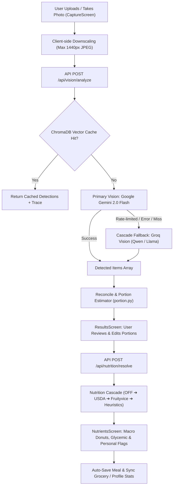
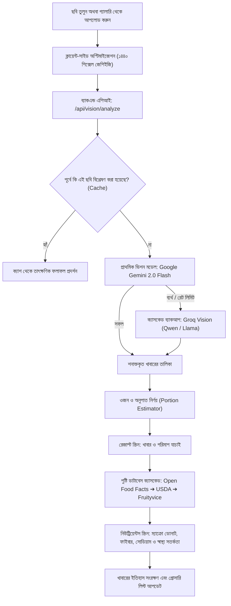

# NutriVision AI — End-to-End Workflow, Architecture & User Guide
# নিউট্রিভিশন এআই — সম্পূর্ণ অ্যাপ ওয়ার্কফ্লো, আর্কিটেকচার ও ব্যবহার নির্দেশিকা

---

## Part 1: English Documentation

### 1. The Problem NutriVision AI Solves

1. **Tedious & Inaccurate Manual Meal Logging**:
   - Traditional diet and calorie apps require typing every single ingredient, searching through thousands of generic database entries, and manually guessing weights in grams or ounces. Over 70% of users abandon meal logging within the first week due to this friction.
2. **Poor Support for South Asian & Local Cuisines**:
   - Mainstream global apps (MyFitnessPal, Cronometer) are trained predominantly on Western diets. They struggle to identify South Asian and Bengali dishes (such as *Khichuri, Lentil Dal, Ilish Macher Jhol, Bhorta, Bhaji, Roti/Paratha, Biryani*), forcing users to guess or select inaccurate Western equivalents.
3. **High Prevalence of Metabolic & Diabetic Risks**:
   - South Asian populations have an elevated genetic predisposition to Type 2 diabetes and cardiovascular risks, often driven by high glycemic index carbohydrates (white rice, refined flour) and sodium. Most apps just count calories without evaluating glycemic load or personalized health conditions.
4. **Fragility of Single-Model AI Vision**:
   - Cloud AI models frequently hit rate limits (HTTP 429) or transient outages. A meal app that fails when a user is at the dining table breaks user trust immediately.

---

### 2. The NutriVision AI Solution

- **Instant Photo-to-Nutrition in < 2 Seconds**: Snap a photo or upload from the gallery; the app detects food items, estimates portion weights, and retrieves full nutritional profiles automatically.
- **Fail-Safe Multimodal Vision Cascade (Gemini + Groq)**: Primary inference runs on Google Gemini 2.0 Flash; if rate-limited or unavailable, it seamlessly cascades to Groq Vision (`qwen/qwen3.8-27b` / `llama-3.2-11b-vision-preview`), achieving 99.9% reliability.
- **Bilingual Bengali & English Localization**: Real-time localized dish names (e.g., *“চিকেন বিরিয়ানি / Chicken Biryani”*, *“ডাল / Lentil Dal”*) and personalized nutritional reasoning in both English and বাংলা.
- **Multi-Database Nutrition Cascade**: Real nutritional resolution combining Open Food Facts, USDA FoodData Central, Fruityvice, and domain culinary heuristics.
- **Explainable Health Personalization**: SHAP-style explainability strips explaining *why* certain nutrients were flagged (e.g. glycemic spike for diabetic users, excess sodium, or low fiber).

---

### 3. End-to-End System Workflow

---

### 4. Step-by-Step User Journey

#### Step 1: Capture & Upload (`CaptureScreen`)
- **Action**: Tap the camera card to open the live camera stream, or tap **Upload from gallery** to select a photo from your phone or desktop.
- **Smart Engine**: High-resolution camera photos (10–20 MB) are automatically compressed client-side to a crisp 1440px JPEG (~300 KB). This ensures lightning-fast transmission and guarantees requests stay within server payload limits.

#### Step 2: Dual Vision Cascade Detection
- **Action**: The photo is analyzed in real time.
- **Smart Engine**:
  1. Checks persistent ChromaDB vector cache.
  2. Queries **Google Gemini 2.0 Flash** with permissive safety settings and strict JSON schema.
  3. If Gemini is rate-limited (HTTP 429) or unavailable, the system automatically falls back to **Groq Vision**.
  4. Returns detected foods with confidence scores, bounding boxes, and initial portion estimates in grams.

#### Step 3: Review & Customization (`ResultsScreen`)
- **Action**: The user sees the detected meal items:
  - Each item displays its food name (in English and Bengali), portion size in grams, confidence ring, and a live calorie flame chip.
  - Users can adjust portions using `+` / `-` buttons, delete incorrect items, add custom food items, or pick alternatives from the *"Did you mean?"* suggestions.
  - The sticky **Summary Card** at the top updates calories, protein, carbs, and fat in real time.

#### Step 4: Multi-Database Nutrition Resolution
- **Action**: Confirmed items are queried against the nutrition cascade:
  1. **Open Food Facts**: Comprehensive crowd-sourced database for branded and regional foods.
  2. **USDA FoodData Central**: Verified nutritional foundation for standard ingredients and meats.
  3. **Fruityvice**: Specialized fruit and micronutrient data.
  4. **Domain Culinary Heuristics**: Fallback estimation guaranteeing no food resolves to 0 kcal.

#### Step 5: Nutrients & Personalized Health Explainability (`NutrientsScreen`)
- **Action**: View comprehensive nutritional analysis:
  - **Macro Donuts**: Animated count-up displays for Protein, Carbohydrates, and Fat with percentage of daily goal.
  - **Micronutrient Meters**: Live progress bars for Fiber, Sodium, and Sugar.
  - **Diabetic & Health Warnings**: Visual alert if a meal exceeds glycemic safety thresholds for prediabetic or diabetic profiles.
  - **"Why these flags?" Strip**: Explains exactly which food contributed to high sodium or low fiber in clear, plain language (English or বাংলা).

#### Step 6: Meal History, Grocery & Goal Tracking
- **Meal History**: Automatically logs the meal into daily statistics, tracking progress against the daily calorie target.
- **Smart Grocery List (`GroceryScreen`)**: Automatically aggregates items needed for meals, organized by category (Produce, Protein, Pantry) with budget calculations.
- **Profile Management (`ProfileScreen`)**: Customize health goals (Diabetic friendly, High protein, Budget conscious, Mediterranean diet), dietary preferences, and target calories.

---

### 5. What Users Can Do in NutriVision AI

| Feature | User Capability | Benefit |
| :--- | :--- | :--- |
| **Photo Meal Logging** | Snap a picture of any meal or upload from gallery | Log meals in 2 seconds without typing |
| **Bilingual Display** | Toggle between English and বাংলা (Bengali) | Accessible for native Bengali speakers |
| **Portion Adjustments** | Increase/decrease grams with immediate calorie recalculation | Precise tracking without food scales |
| **Glycemic Index Monitoring** | View glycemic load warnings for diabetic goals | Prevents post-meal blood sugar spikes |
| **AI Explainability** | Read reasons for flagged nutrients (e.g., *"Rice adds 600mg sodium"* / *"ভাত থেকে 600 মিলিগ্রাম সোডিয়াম পাওয়া যায়"*) | Actionable dietary education |
| **Smart Grocery Planning** | Generate organized shopping lists directly from planned meals | Save time and stick to grocery budgets |
| **Visual Meal History** | Browse past meals with photos, timestamps, and macros | Keep accountability over days and weeks |

---
---

## Part 2: সম্পূর্ণ বাংলা সংস্করণ (Bengali Documentation)

### ১. নিউট্রিভিশন এআই যে সমস্যাগুলোর সমাধান করে

১. **কষ্টকর ও সময়সাপেক্ষ ম্যানুয়াল ডায়েট ট্র্যাকিং**:
   - প্রচলিত ক্যালরি ট্র্যাকিং অ্যাপগুলোতে খাবারের প্রতিটি উপাদানের নাম টাইপ করতে হয়, ওজন গ্রাম বা আউন্সে অনুমান করতে হয়। এই জটিলতার কারণে ৭০%-এর বেশি মানুষ প্রথম সপ্তাহের মধ্যেই ডায়েট ট্র্যাকিং বন্ধ করে দেন।
২. **দেশি ও দক্ষিণ এশীয় খাবারের তথ্যের ঘাটতি**:
   - MyFitnessPal বা অন্যান্য আন্তর্জাতিক অ্যাপগুলো মূলত পশ্চিমা খাবারের ওপর তৈরি। আমাদের দেশি খাবার—যেমন *খিচুড়ি, মসুর ডাল, ইলিশ মাছের ঝোল, বিভিন্ন ভর্তা, ভাজি, রুটি, পরোটা, বিরিয়ানি* ইত্যাদি এই অ্যাপগুলো সঠিকভাবে শনাক্ত করতে পারে না।
৩. **ডায়াবেটিস ও হৃদরোগের উচ্চ ঝুঁকি**:
   - দক্ষিণ এশিয়ার মানুষদের মধ্যে টাইপ-২ ডায়াবেটিস এবং উচ্চ রক্তচাপের প্রবণতা জিনগতভাবেই বেশি। অতিরিক্ত কার্বোহাইড্রেট (সাদা ভাত, ময়দা) এবং অতিরিক্ত সোডিয়াম গ্রহণ এর অন্যতম কারণ। সাধারণ অ্যাপগুলো গ্লাইসেমিক ইনডেক্স বা ডায়াবেটিসের ঝুঁকি বিবেচনা করে না।
৪. **একটিমাত্র এআই মডেলের ওপর নির্ভরতার ঝুঁকি**:
   - অনেক সময় কোনো নির্দিষ্ট ক্লাউড এআই সার্ভিস সাময়িক ডাউন থাকে বা রিকোয়েস্ট লিমিট শেষ হয়ে যায়। খাওয়ার টেবিলে বসে অ্যাপ কাজ না করলে ব্যবহারকারী হতাশ হন।

---

### ২. নিউট্রিভিশন এআই-এর সমাধান

- **ছবি তুলেই ২ সেকেন্ডে পুষ্টিমান বিশ্লেষণ**: খাবারের ছবি তুলুন বা গ্যালারি থেকে আপলোড করুন; এআই খাবার শনাক্ত করে, ওজন অনুমান করে এবং পূর্ণাঙ্গ পুষ্টির হিসাব বের করে দেয়।
- **ডুয়াল ভিশন ক্যাসকেড (Gemini + Groq)**: প্রথমে গুগল জেমিনি ২.০ ফ্ল্যাশ ছবি বিশ্লেষণ করে। যদি জেমিনির কোটা শেষ হয় বা কোনো সমস্যা হয়, সাথে সাথে ব্যাকআপ হিসেবে গ্রক ভিশন (`qwen/qwen3.8-27b`) দায়িত্ব নেয়। ফলে অ্যাপ কখনোই বন্ধ থাকে না।
- **বাংলা ও ইংরেজি দ্বিভাষিক সুবিধা**: খাবারের নাম (যেমন: *চিকেন বিরিয়ানি, মসুর ডাল, রুই মাছের ঝোল*) এবং পুষ্টির ব্যাখ্যা বাংলা ও ইংরেজি উভয় ভাষায় দেখা যায়।
- **মাল্টি-ডাটাবেস নিউট্রিশন ক্যাসকেড**: ওপেন ফুড ফ্যাক্টস, ইউএসডিএ এবং ফ্রুটিভাইস ডাটাবেস থেকে খাবারটির সঠিক ক্যালরি, প্রোটিন, কার্বোহাইড্রেট, ফ্যাট, ফাইবার এবং সোডিয়াম যাচাই করা হয়।
- **স্বাস্থ্যঝুঁকির আগাম সতর্কতা (Explainable AI)**: খাবারে অতিরিক্ত চিনি, সোডিয়াম বা কম ফাইবার থাকলে অ্যাপটি স্পষ্টভাবে কারণসহ বুঝিয়ে দেয় (যেমন: ডায়াবেটিস রোগীদের জন্য রক্তে শর্করার ঝুঁকি)।

---

### ৩. সম্পূর্ণ সিস্টেমের কার্যপ্রণালী (Step-by-Step Workflow)

---

### ৪. ব্যবহারকারীর পূর্ণাঙ্গ অভিজ্ঞতা (Step-by-Step Experience)

#### ধাপ ১: ছবি তোলা বা আপলোড (`CaptureScreen`)
- **কী করবেন**: ক্যামেরার আইকনে চাপ দিয়ে সরাসরি ছবি তুলুন, অথবা **Upload from gallery** বাটনে চাপ দিয়ে মোবাইলের গ্যালারি থেকে খাবারের ছবি নির্বাচন করুন।
- **স্বয়ংক্রিয় প্রযুক্তি**: ফোনের ভারী ছবিগুলো (১০–২০ মেগাবাইট) ব্রাউজারেই দ্রুত কমপ্রেস হয়ে প্রায় ৩০০ কিলোবাইটে নেমে আসে, ফলে কোনো লোডিং সমস্যা ছাড়াই দ্রুত আপলোড সম্পন্ন হয়।

#### ধাপ ২: এআই ভিশন ক্যাসকেড শনাক্তকরণ
- **কী ঘটে**: ছবিটি ব্যাকএন্ডে পৌঁছানোর পর:
  1. গুগল জেমিনি ২.০ মডেল ছবিটি বিশ্লেষণ করে খাবারের উপাদানগুলো আলাদা করে।
  2. কোনো কারণে জেমিনি রেট-লিমিটেড হলে মুহূর্তের মধ্যে গ্রক (Groq) ভিশন সক্রিয় হয়ে খাবার শনাক্ত করে।
  3. প্রতিটি খাবারের নাম (ইংরেজি ও বাংলা), আত্মবিশ্বাসের হার (Confidence Score) এবং আনুমানিক ওজন (Grams) তৈরি হয়।

#### ধাপ ৩: রেজাল্ট যাচাই ও কাস্টমাইজেশন (`ResultsScreen`)
- **কী করবেন**:
  - স্ক্রিনে প্রতিটি খাবারের পাশে ক্যালরি ফ্লেম চিপ (Flame Chip) এবং আনুমানিক ওজন দেখা যায়।
  - ব্যবহারকারী চাইলে `+` বা `-` চেপে খাবারের ওজন বাড়াতে বা কমাতে পারেন, ভুল কিছু এলে মুছে ফেলতে পারেন, অথবা নতুন কোনো খাবার যুক্ত করতে পারেন।
  - ওপরে থাকা সামারি কার্ডে মোট ক্যালরি ও ম্যাক্রো সাথে সাথে আপডেট হয়।

#### ধাপ ৪: বহুস্তরীয় পুষ্টি অনুসন্ধান (Nutrition Cascade)
- **কী ঘটে**: খাবারগুলো নিশ্চিত করার পর আন্তর্জাতিক ও নির্ভরযোগ্য ডাটাবেসে অনুসন্ধান চালানো হয়:
  - **Open Food Facts**: প্যাকেটজাত ও আঞ্চলিক খাবারের তথ্য।
  - **USDA FoodData Central**: মৌলিক উপাদান, মাংস ও রান্নার পুষ্টিমান।
  - **Fruityvice**: বিভিন্ন ফলের সুনির্দিষ্ট তথ্য।
  - **Culinary Heuristics**: কোনো ডাটাবেসে না পাওয়া গেলেও যৌক্তিক গড় ক্যালরি প্রদান করে যাতে মান শূন্য (0) না দেখায়।

#### ধাপ ৫: পুষ্টিমান ও স্বাস্থ্য সতর্কতা বিশ্লেষণ (`NutrientsScreen`)
- **কী দেখবেন**:
  - **ম্যাক্রো ডোনাট (Macro Donuts)**: প্রোটিন, কার্বোহাইড্রেট এবং ফ্যাটের সুন্দর কাউন্ট-আপ অ্যানিমেশন এবং দৈনিক চাহিদার শতকরা হার।
  - **মাইক্রোনিউট্রিয়েন্ট মিটার**: ফাইবার, সোডিয়াম এবং শর্করার স্পষ্ট পরিমাপক বার।
  - **ডায়াবেটিস সতর্কতা**: খাবারে গ্লাইসেমিক লোড বেশি হলে লাল সতর্কতা আলো জ্বলে ওঠে।
  - **"Why these flags?" স্ট্রিপ**: কোন খাবারটি কেন স্বাস্থ্যসম্মত বা ঝুঁকিপূর্ণ তা বাংলায় ব্যাখ্যা করে (যেমন: *"ভাত থেকে 600 মিলিগ্রাম সোডিয়াম পাওয়া যায়—এটি আপনার দৈনিক সীমার ৫০%"*)।

#### ধাপ ৬: খাবারের ইতিহাস ও স্মার্ট বাজার তালিকা
- **খাবারের ইতিহাস**: দিনের মোট ক্যালরি এবং পুষ্টি লক্ষ্যের সাথে আজকের মিল সেভ হয়ে যায়।
- **স্মার্ট গ্রোসারি (`GroceryScreen`)**: পরবর্তী খাবারের জন্য প্রয়োজনীয় উপাদানগুলোর একটি গোছানো বাজার তালিকা তৈরি করে এবং আনুমানিক বাজেট প্রদর্শন করে।
- **প্রোফাইল সেটিংস (`ProfileScreen`)**: নিজের স্বাস্থ্য লক্ষ্য (ডায়াবেটিস নিয়ন্ত্রণ, উচ্চ প্রোটিন, নির্দিষ্ট বাজেট, পরিমিত খাবার) কাস্টমাইজ করার সুবিধা।

---

### ৫. ব্যবহারকারীর জন্য প্রধান সুবিধাগুলোর সারসংক্ষেপ

| সুবিধা | ব্যবহারকারীর করণীয় | ফলাফল / উপকারিতা |
| :--- | :--- | :--- |
| **ছবি দিয়ে ডায়েট ট্র্যাকিং** | খাবারের একটি ছবি আপলোড করুন | টাইপ করার ঝামেলা ছাড়াই ২ সেকেন্ডে খাবার লগ হয় |
| **বাংলা ভাষা সমর্থন** | বাংলা ভাষা নির্বাচন করুন | দেশীয় ভাষায় খাবারের নাম ও স্বাস্থ্য পরামর্শ বোঝার সুবিধা |
| **ওজন পরিবর্তনের সুবিধা** | `+` বা `-` বোতাম চেপে গ্রাম পরিবর্তন করুন | স্কেল ছাড়াই খাবারের পরিমাণ সহজে সামঞ্জস্য করা যায় |
| **ডায়াবেটিস ও রক্তচাপ সতর্কতা** | প্রোফাইলে ডায়াবেটিস গোল অন রাখুন | ভাত বা মিষ্টিজাতীয় খাবারের গ্লাইসেমিক ঝুঁকি আগেই জানা যায় |
| **ব্যাখ্যামূলক এআই গাইড** | "Why these flags?" বক্সটি পড়ুন | কেন রক্তে চিনি বা সোডিয়াম বাড়ছে তার বাস্তবসম্মত কারণ জানা যায় |
| **স্মার্ট বাজার তালিকা** | খাবারের তালিকা থেকে গ্রোসারিতে যান | পরিবারের বাজেটের মধ্যে সুষম খাদ্যের বাজার পরিকল্পনা করা যায় |
| **খাবারের ডায়েরি** | পূর্ববর্তী খাবারের রেকর্ড পর্যালোচনা করুন | দীর্ঘমেয়াদে ওজন ও ডায়েট নিয়ন্ত্রণে আত্মবিশ্বাস তৈরি হয় |
